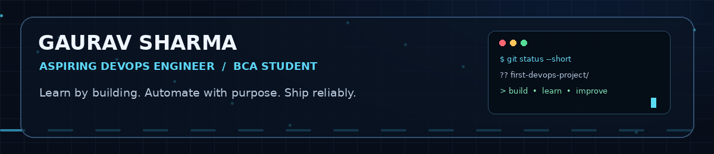
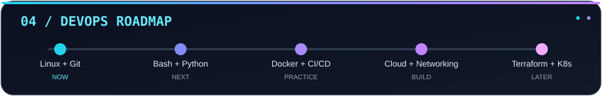
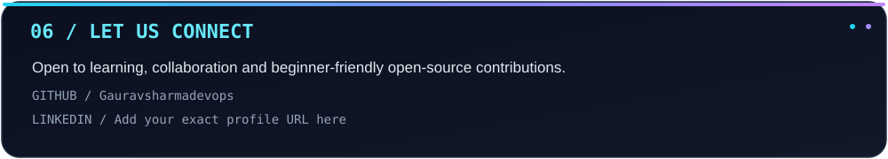

<!-- Profile repository: Gauravsharmadevops -->

  
  
  

<a href="https://github.com/Gauravsharmadevops?tab=repositories">Explore repositories</a> &nbsp; · &nbsp; <a href="https://github.com/Gauravsharmadevops">GitHub profile</a>

---

&nbsp;

&nbsp;

&nbsp;

&nbsp;

&nbsp;

---

<strong>CONTRIBUTION ACTIVITY</strong> Animated contribution snake appears after the GitHub Actions workflow runs successfully.

Built with Markdown, animated GIF, SVG assets and GitHub Actions. GitHub README does not run custom page JavaScript or CSS.

