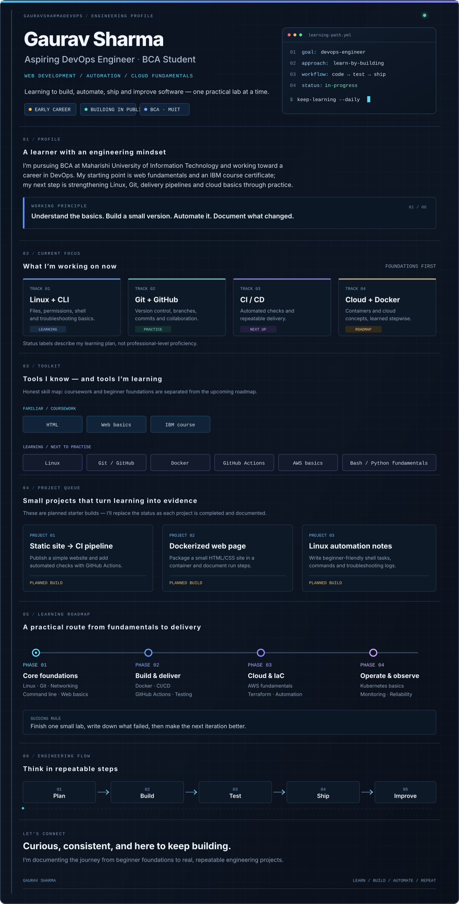

<!--
  Gaurav Sharma | Engineering Profile
  Repository name must match the GitHub username: Gauravsharmadevops
  Edit assets/engineering-profile.svg to change the visual profile.
-->

  

  
  
  

  <a href="https://github.com/Gauravsharmadevops?tab=repositories">Explore repositories</a>
  &nbsp; · &nbsp;
  <a href="https://github.com/Gauravsharmadevops?tab=projects">Learning projects</a>
  &nbsp; · &nbsp;
  <a href="https://github.com/Gauravsharmadevops">GitHub profile</a>

---

<strong>CONTRIBUTION ACTIVITY</strong> Updates automatically after the contribution-snake workflow is enabled.

  

Designed as one continuous engineering profile. Built with SVG animation and GitHub Actions; no JavaScript or injected CSS in the README.

