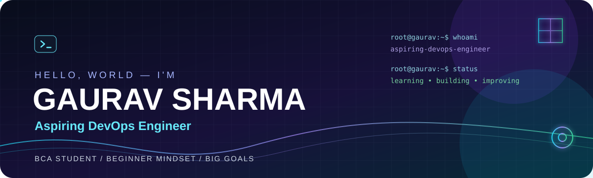

### `BUILD • AUTOMATE • SHIP • IMPROVE`

*BCA Student · Aspiring DevOps Engineer · Learning in public*

[About Me](#-about-me) · [Tech Stack](#-tech-stack) · [Projects](#-projects) · [Roadmap](#-learning-roadmap) · [Contact](#-contact)

---

## 📂 Separate Sections

- [About Me](sections/ABOUT.md)
- [Tech Stack](sections/TECH-STACK.md)
- [Projects](sections/PROJECTS.md)
- [Learning Roadmap](sections/ROADMAP.md)
- [Contact](sections/CONTACT.md)

## 👨‍💻 About Me

Hey! I'm **Gaurav Sharma**, a BCA student at **Maharishi University of Information Technology**, working toward a career in **DevOps Engineering**.

I'm at the beginning of my coding journey and focused on building strong fundamentals. I want to understand how software is developed, automated, deployed, and maintained reliably.

- 🌱 Learning step by step and documenting my progress.
- 🧭 Exploring Linux, Git/GitHub, networking, scripting, CI/CD, containers, and cloud.
- 🧪 I believe in learning by building small, practical projects.
- 🎯 Long-term goal: become a skilled DevOps Engineer.
- ⚡ My mindset: **Learn it. Build it. Automate it.**

> This profile is my learning journey. The technologies below include tools I’m learning or plan to explore—not a claim of professional proficiency.

## 🧰 Tech Stack & Learning

| Focus | What I'm working toward |
|---|---|
| **Foundations** | Git, GitHub, terminal, Linux basics |
| **Scripting** | Bash and Python fundamentals |
| **Containers** | Docker images, containers, volumes |
| **Automation** | CI/CD with GitHub Actions |
| **Cloud & Operations** | Cloud basics, monitoring, troubleshooting |

## 🚀 Projects

These are project goals. I'll update the cards with real repository links as I complete each one.

<table>
<tr>
<td width="50%" valign="top">

### 🧭 DevOps Learning Log
A simple record of commands, concepts, weekly goals, and lessons learned.

**Planned tools:** Markdown · Git · Linux

</td>
<td width="50%" valign="top">

### ⚙️ CI/CD Demo
A beginner project that runs automated checks whenever code is pushed.

**Planned tools:** GitHub Actions · Git

</td>
</tr>
<tr>
<td width="50%" valign="top">

### 🐳 Docker Starter
Package a small static website into a container and document how to run it.

**Planned tools:** Docker · HTML/CSS

</td>
<td width="50%" valign="top">

### ☁️ Cloud Notes
Beginner-friendly notes and diagrams explaining cloud and deployment concepts.

**Planned tools:** Markdown · Diagrams

</td>
</tr>
</table>

## 📈 GitHub Stats

 

## 🐍 Contribution Snake

*The animation will appear after you upload the included workflow and run it successfully from the Actions tab.*

## 🗺️ Learning Roadmap

- [ ] **Phase 1:** Git, GitHub, command line, Linux basics
- [ ] **Phase 2:** Networking fundamentals and Bash scripting
- [ ] **Phase 3:** Python basics and Docker
- [ ] **Phase 4:** GitHub Actions and CI/CD fundamentals
- [ ] **Phase 5:** Cloud fundamentals, deployment, logs, and monitoring

See the detailed checklist in [`sections/ROADMAP.md`](sections/ROADMAP.md).

## 📬 Contact

- **GitHub:** [@Gauravsharmadevops](https://github.com/Gauravsharmadevops)
- **LinkedIn:** Add your real LinkedIn profile URL in [`sections/CONTACT.md`](sections/CONTACT.md).
- **Email:** Add a professional email only if you want it to be public.

Designed with curiosity by Gaurav Sharma · Updated as I learn

